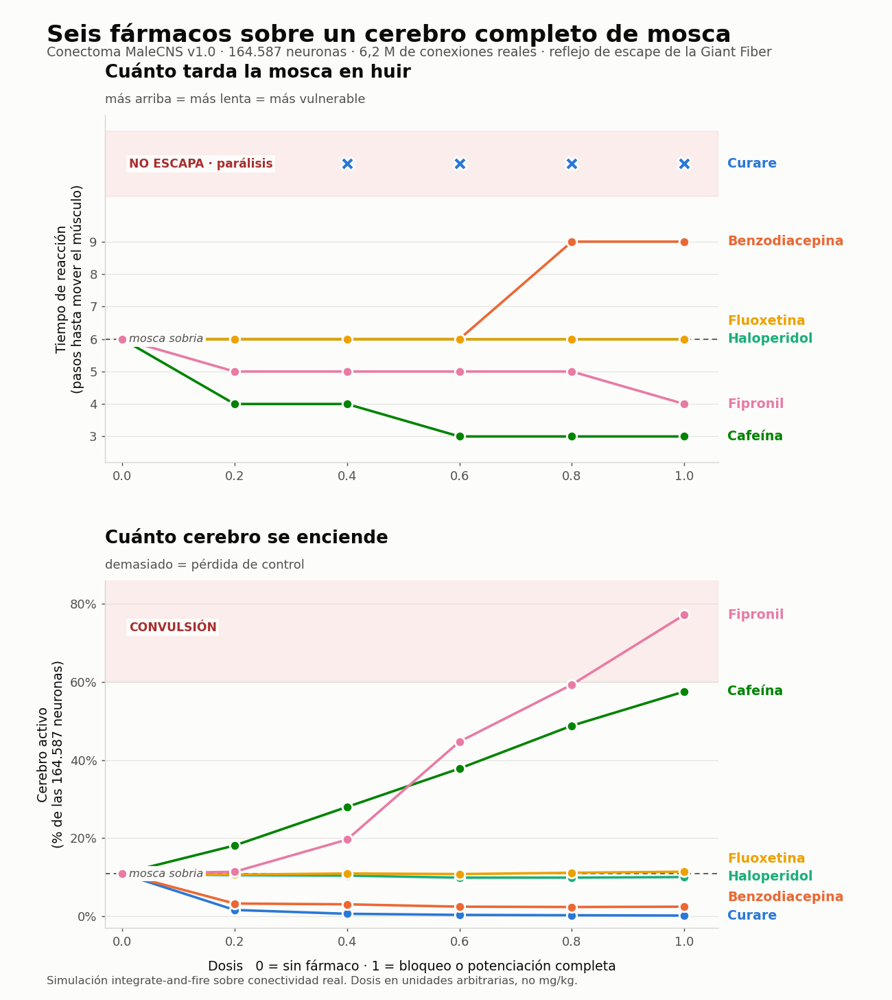

# FlyPharm

**¿Qué le pasa a un cerebro entero cuando le das un fármaco?** Una mosca digital sobre el cableado *real* de un cerebro de *Drosophila*, para ver cómo reacciona a seis fármacos.

Proyecto de divulgación, nacido para la Noche Europea de los Investigadores: que cualquiera pueda dosificar una mosca, mirar su cerebro en 3D y ver cómo se rompe su conducta.

**▶ Demo en vivo: https://miriammartinezsantos625-source.github.io/flypharm/**



> **Qué es y qué no es.** Es una herramienta didáctica y una demostración de método sobre datos abiertos. **No es un resultado científico**: las dosis son unidades arbitrarias y el modelo es deliberadamente simple (ver [Limitaciones](#limitaciones)).

## Qué hace

Una app web interactiva con tres paneles:

- **La mosca** (modelo anatómico real, en 3D) vuela, busca comida, se posa y huye de una sombra que se acerca.
- **Su cerebro**, en 3D y rotable, con las neuronas encendiéndose en tiempo real.
- **Un armario de fármacos** con seis sliders: curare, benzodiacepina, haloperidol, fluoxetina, cafeína y fipronil.

Se puede usar directamente en la [demo en vivo](https://miriammartinezsantos625-source.github.io/flypharm/). Y en local no hace falta descargar nada: `web/` ya contiene los datos procesados.

```bash
python3 -m http.server --directory web 8765   # y abre http://localhost:8765
```

## Cómo está construido, desde la ciencia

1. **Los datos.** [MaleCNS v1.0](https://male-cns.janelia.org/) (Berg *et al.*, *Cell* 2026): el conectoma completo del sistema nervioso central del macho de *Drosophila melanogaster*. 164.587 neuronas y 124 millones de sinapsis reconstruidas por microscopía electrónica.
2. **El grafo.** Se filtran las conexiones con ≥5 sinapsis (ruido de reconstrucción): 6,2 millones de aristas que conservan el 72 % del total de sinapsis.
3. **El signo de cada conexión.** Cada neurona trae su neurotransmisor predicho (el 98 % están clasificadas). La acetilcolina excita; GABA, glutamato e histamina inhiben. *Ojo: el glutamato es inhibidor en la mosca (canales de cloro GluCl), al contrario que en mamíferos.*
4. **La dinámica.** Un modelo de **integración y disparo con fugas**: cada neurona suma lo que recibe (normalizado por su total de sinapsis de entrada), pierde un poco en cada paso, y dispara al cruzar un umbral. Es multiplicar una matriz dispersa en bucle.
5. **Calibración.** El umbral tiene una ventana estrecha (por debajo de 0,08 todo el cerebro convulsiona; por encima de 0,12 no responde nada) y se fija en 0,09.
6. **Validación.** Sin imponerlo, las dos mayores entradas a la *Giant Fiber* (DNp01, la neurona del reflejo de escape) resultan ser **LC4 y LPLC2**, los detectores de objetos que se acercan. Coincide con la literatura experimental. Desde la *Giant Fiber* se alcanzan 808 de las 815 motoneuronas, casi todas a 3 saltos sinápticos.
7. **Un fármaco es una operación sobre la matriz.** Bloquear la dopamina es multiplicar por (1 − dosis) las columnas de las 392 neuronas dopaminérgicas; potenciar el GABA es multiplicar por (1 + 2·dosis) las de 22.055 neuronas GABAérgicas; la cafeína baja el umbral global.
8. **Un grupo control en vivo.** En la app corren **dos cerebros idénticos a la vez con el mismo estímulo**: la mosca drogada y su gemela sobria. La conducta se decide siempre como el cociente drogada / sobria, nunca con constantes absolutas, porque la red vive cerca de un punto crítico y cualquier valor fijo se rompe.

### Resultados del ensayo (`src/04_ensayo.py`)

Reflejo de escape: se estimulan los detectores LC4 y LPLC2 (la sombra) y se mide cuándo y con cuánta fuerza responden las motoneuronas.

| Condición | Diana | Dosis | Tiempo de reacción | Motoneuronas | Cerebro activo | Resultado |
|---|---|---|---|---|---|---|
| Mosca sobria (control) | — | 0 | 6 pasos | 113 | 10,9 % | referencia |
| Curare | bloquea acetilcolina (63 % del cerebro) | 0,2 | — | 15 | 1,6 % | no escapa (parálisis) |
| Benzodiacepina | potencia GABA (22,055 neuronas) | 1 | 9 pasos | 28 | 2,5 % | escapa 3 pasos más tarde |
| Haloperidol | bloquea dopamina (392 neuronas) | 1 | 6 pasos | 81 | 10,1 % | sin cambio claro |
| Fluoxetina | potencia serotonina (48 neuronas) | 1 | 6 pasos | 123 | 11,4 % | sin cambio claro |
| Cafeína | baja el umbral de disparo global | 1 | 3 pasos | 647 | 57,6 % | escapa 3 pasos antes |
| Fipronil (insecticida) | bloquea GABA y glutamato | 1 | 4 pasos | 793 | 77,2 % | convulsiona |

Dos cosas que importan: la **parálisis con curare** y la **convulsión con fipronil** son resultados coherentes con su mecanismo (no hay escape sin acetilcolina; sin inhibición no hay conducta, solo ruido). Y **el haloperidol y la fluoxetina casi no cambian nada**, lo que en parte es correcto (un antipsicótico no anula el sobresalto) y en parte una limitación del modelo.

Datos que llaman la atención: toda la serotonina de este cerebro cabe en **48 neuronas** y la dopamina en **392**, de 164.587. Los neuromoduladores son el 0,3 % del cerebro.

## Limitaciones

Importa decirlas con claridad:

- **Las dosis son unidades arbitrarias**, no mg/kg. No hay farmacocinética.
- **Un modelo de disparo no captura la neuromodulación lenta** (receptores acoplados a proteína G), que es justo cómo actúan dopamina y serotonina. Por eso casi no se mueven.
- **La conducta es una convención mía, no algo que dicte el conectoma.** Que la mosca gire hacia la comida, o que vuele solo si su salida motora supera un umbral, son reglas que he puesto yo sobre la actividad de la red.
- **La animación es mía, no física.** El cuerpo es real; el batido de alas, las patas recogidas y la marcha en trípode son animación sobre sus articulaciones.
- **Un solo individuo, un solo sexo.** MaleCNS es un macho. No se generaliza a hembras ni a la especie.
- **Un subconjunto.** La app corre 31.000 de las 164.587 neuronas (todas las motoneuronas, sensoriales, descendentes y neuromoduladoras, más las mejor conectadas) para caber en un navegador.
- **La mosca no siente nada.** No está consciente ni sufre. Es propagación de señal sobre un grafo.

## Reproducirlo desde cero

Probado con Python 3.12. Para el vídeo (`06`) hace falta `ffmpeg`.

```bash
pip install -r requirements.txt
python3 src/00_descargar_datos.py      # ~700 MB desde las fuentes originales
python3 src/01_construir_dataset.py    # datos crudos -> neuronas y conexiones limpias
python3 src/03_calibrar.py             # barrido del umbral de disparo
python3 src/04_ensayo.py               # curvas dosis-respuesta
python3 src/05_figura.py               # figura
python3 src/07_exportar_web.py         # conectoma reducido para el navegador
python3 src/08_exportar_mosca3d.py     # cuerpo 3D decimado
python3 src/09_construir_html.py       # web/index.src.html -> web/index.html
```

La app se edita en `web/index.src.html` (UTF-8); `09` genera `web/index.html` en ASCII para que los acentos sobrevivan en cualquier servidor.

## Estructura

```
src/00_descargar_datos.py   descarga MaleCNS + flybody desde sus fuentes
src/01_construir_dataset.py datos crudos -> procesados
src/simulador.py            integración y disparo sobre la matriz dispersa
src/farmacos.py             la farmacia: cada fármaco, una operación sobre la matriz
src/03_calibrar.py ... 06   calibración, ensayo, figura, vídeo
src/07_exportar_web.py      conectoma reducido -> web/datos.json
src/08_exportar_mosca3d.py  flybody decimado -> web/mosca3d.json
web/                        la app (HTML + Three.js desde cdnjs)
outputs/                    figura, tabla de resultados y vídeo
```

## Créditos

Todo el trabajo difícil lo hicieron otros: el conectoma lo reconstruyeron Janelia FlyEM, Cambridge, el MRC LMB y Google Research; el cuerpo lo modelaron Janelia y Google DeepMind. Referencias, licencias y cambios realizados, en [NOTICE.md](NOTICE.md).

## Licencia

El código propio de este repositorio se publica bajo licencia **MIT** ([LICENSE](LICENSE)). Los datos derivados del conectoma (CC-BY) y el cuerpo 3D (Apache-2.0) conservan sus licencias originales; ver [NOTICE.md](NOTICE.md).
